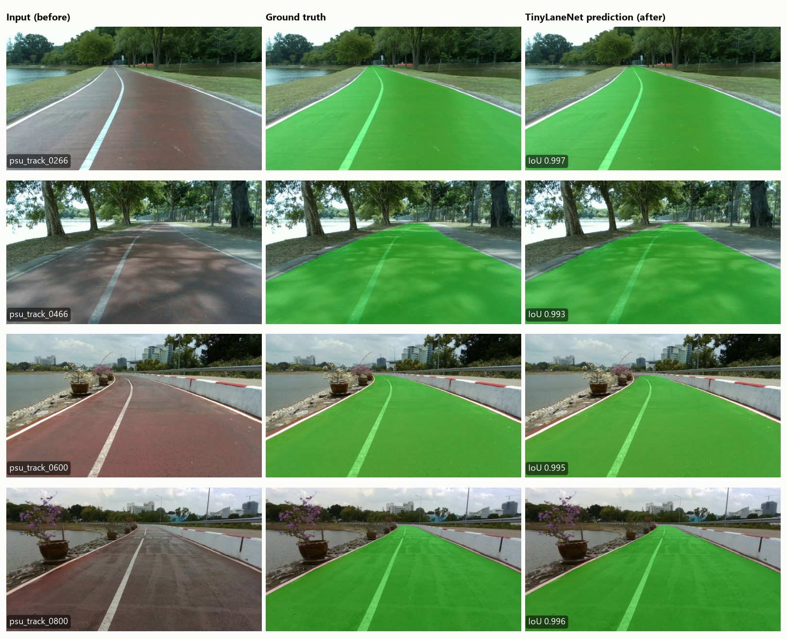
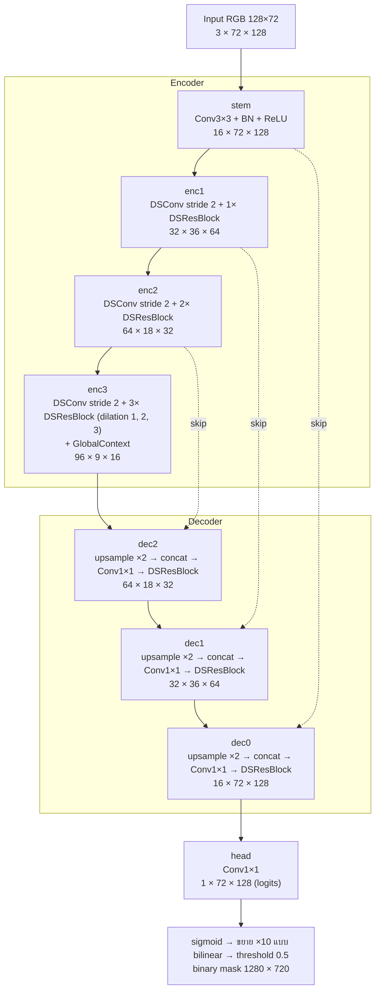
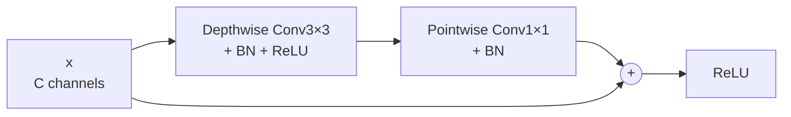
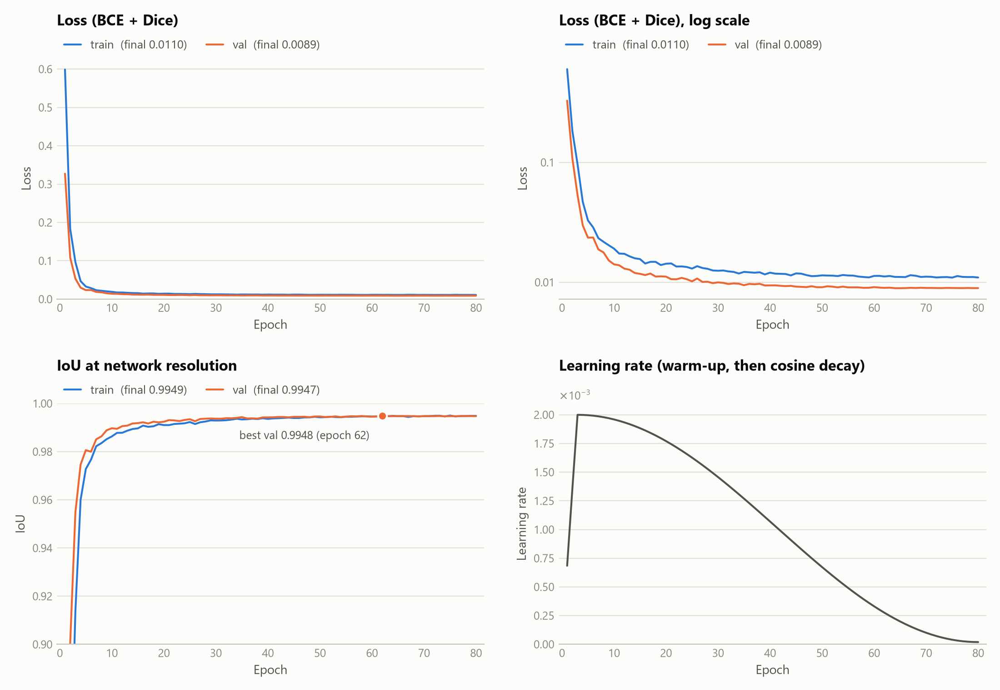
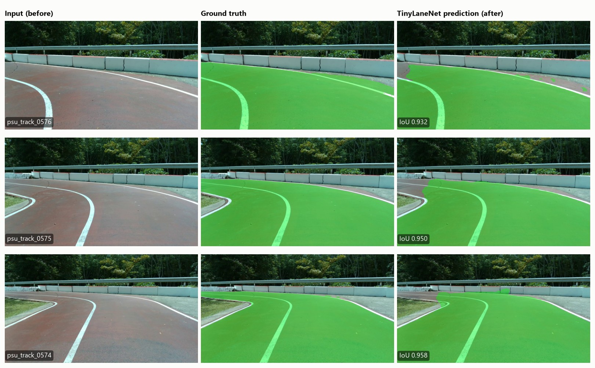

# TinyLaneNet — Lane Segmentation ที่ออกแบบเองและเทรนจากศูนย์

Assignment-10 · ออกแบบ Convolutional Neural Network สำหรับ lane segmentation ขึ้นเอง แล้วเทรน**ทุก layer ใหม่ทั้งหมด** (ไม่ใช้ pretrained weights) บน PSU Reservoir Track dataset โดยให้มีขนาดเล็กพอที่จะรันบน laptop/PC ธรรมดาได้โดยไม่ต้องมี GPU

| | |
|---|---|
| Network | **TinyLaneNet** — encoder–decoder แบบ depthwise-separable ที่ออกแบบเอง |
| ขนาด | **79,353 parameters** = 0.31 MB (น้อยกว่า UNet ต้นแบบของวิชา 98 เท่า) |
| Input → Output | RGB 128×72 → lane mask 128×72 → ขยายกลับเป็น binary mask 1280×720 |
| ข้อมูล | PSU Reservoir Track 1,000 เฟรม ใช้เฉพาะ polygon ของ class `Lane` แบ่ง train+val : test = 65 : 35 |
| ผลบน test set (350 เฟรม) | Detection rate (IoU ≥ 0.6) = **100 %** · Average IoU = **0.9939** |
| Memory ตอน inference | weights 0.31 MB + activations 5.2 MB = **5.5 MB** (ทั้ง process ใช้ RAM ~0.5 GB ซึ่งเกือบทั้งหมดคือ PyTorch runtime) |
| ความเร็ว | 18.5 ms ต่อเฟรม (54 FPS) บน CPU รวมการย่อภาพและขยาย mask กลับเป็น 1280×720 |
| การเทรน | 80 epochs บน CPU (Intel Core i5-10300H) ใช้เวลา 12.5 นาที |



**สารบัญ** — [1. Dataset](#1-dataset-และการแบ่งข้อมูล) · [2. โครงสร้าง Network และเหตุผล](#2-โครงสร้าง-neural-network-และเหตุผล) · [3. การเทรนและกราฟ loss](#3-การเทรนและกราฟ-loss) · [4. ผลการวัดประสิทธิภาพ](#4-ผลการวัดประสิทธิภาพ) · [5. ภาพก่อน/หลัง inference](#5-ตัวอย่างภาพก่อนหลัง-inference) · [6. Memory footprint](#6-memory-footprint-ตอน-inference) · [7. วิธีใช้งาน](#7-วิธีใช้งาน) · [8. โครงสร้างไฟล์](#8-โครงสร้างไฟล์) · [9. ข้อจำกัด](#9-ข้อจำกัด) · [10. อ้างอิง](#10-อ้างอิง)

---

## 1. Dataset และการแบ่งข้อมูล

- **PSU Reservoir Track** (จาก Assignment-8): 1,000 เฟรมขนาด 1280×720 จากการวิ่งต่อเนื่องรอบอ่างเก็บน้ำ ม.อ. annotate ด้วย CVAT แล้ว export เป็น Ultralytics YOLO-seg
- dataset ต้นทางมี 5 class (`Lane`, `Track_Line_L/C/R`, `Sideway`) งานนี้ใช้**เฉพาะ polygon ของ class `Lane`** เท่านั้น — [prepare_data.py](prepare_data.py) คัดเฉพาะ class 0 แล้วทิ้ง polyline / class อื่นทั้งหมด (ได้ 1,003 polygon ครบทุกเฟรม)
- Lane กินพื้นที่เฉลี่ย 52.5 % ของภาพ (39–76 %)
- ตัว dataset ไม่ได้อยู่ใน repo นี้ (ขนาด ~270 MB) รายชื่อเฟรมของแต่ละ split อยู่ใน [splits/](splits)

### แบ่ง 65 : 35 แบบเป็นช่วงตามลำดับเวลา

เฟรมทั้งหมดมาจากการวิ่งรอบเดียวต่อเนื่อง เฟรมที่อยู่ติดกันจึงเป็นฉากเดียวกันแทบทั้งหมด ถ้าสุ่มแบ่ง เฟรมใน test เกือบทุกเฟรมจะมีเฟรม train อยู่ถัดไปเพียง 1–2 เฟรม ผลที่วัดได้จะดีเกินจริง จึงตัดลำดับเฟรมเป็นช่วงละ 100 เฟรม แล้วแบ่งภายในแต่ละช่วงตามลำดับเวลา:

```
เฟรมในแต่ละช่วง:   1 ........................ 58 | 59 ... 65 | 66 ................ 100
                   └────────── train ─────────┘ └── val ──┘ └────── test ───────┘
```

| Split | จำนวนเฟรม | สัดส่วน | ใช้ทำอะไร |
|---|---:|---:|---|
| train | 580 | 58 % | เทรน |
| val | 70 | 7 % | เลือก checkpoint ที่ดีที่สุด (`best.pt`) |
| **test** | **350** | **35 %** | วัดผลครั้งสุดท้ายเท่านั้น ไม่ถูกใช้ระหว่างออกแบบหรือเทรน |

ทุกส่วนของสนามยังมีตัวแทนอยู่ใน train แต่เฟรม test แต่ละเฟรมอยู่ในช่วง 35 เฟรมต่อเนื่องที่ network ไม่เคยเห็น

---

## 2. โครงสร้าง Neural Network และเหตุผล

โค้ดอยู่ใน [model.py](model.py) (class `TinyLaneNet`)

### 2.1 ภาพรวม



Building block หลักคือ **DSResBlock** — residual block ที่มี depthwise-separable convolution หนึ่งชั้น:



### 2.2 สรุปทีละ stage

| Stage | Operation | Output (C × H × W) | Parameters |
|---|---|---|---:|
| input | RGB ช่วง [0, 1] → normalize ด้วย mean/std ของ train set (อยู่ใน model) | 3 × 72 × 128 | 0 |
| stem | Conv3×3 + BN + ReLU | 16 × 72 × 128 | 464 |
| enc1 | DSConv stride 2 + 1× DSResBlock | 32 × 36 × 64 | 2,192 |
| enc2 | DSConv stride 2 + 2× DSResBlock | 64 × 18 × 32 | 12,384 |
| enc3 | DSConv stride 2 + 3× DSResBlock (dilation 1, 2, 3) + GlobalContext | 96 × 9 × 16 | 43,160 |
| dec2 | bilinear ×2 + concat(enc2) + Conv1×1 + DSResBlock | 64 × 18 × 32 | 15,296 |
| dec1 | bilinear ×2 + concat(enc1) + Conv1×1 + DSResBlock | 32 × 36 × 64 | 4,576 |
| dec0 | bilinear ×2 + concat(stem) + Conv1×1 + DSResBlock | 16 × 72 × 128 | 1,264 |
| head | Conv1×1 | 1 × 72 × 128 | 17 |
| **รวม** | | | **79,353** |

คำนวณประมาณ 50 M multiply–accumulate ต่อเฟรม (UNet ต้นแบบที่ input เท่ากัน: 1,681 M)

### 2.3 เหตุผลของการออกแบบ

จุดตั้งต้นคือลักษณะของโจทย์: lane เป็นพื้นที่ก้อนใหญ่ก้อนเดียว (ราวครึ่งภาพ) รูปร่างเรียบง่าย กล้องติดกับรถจึงเห็น lane ที่ตำแหน่งคล้ายเดิมทุกเฟรม สิ่งที่ยากมีแค่ **ตำแหน่งขอบ** และบริเวณที่สีของพื้นไม่ชัด (ร่มเงา, ลายที่ทาบนพื้น) จึงไม่จำเป็นต้องใช้ network ใหญ่ เป้าหมายคือ network ที่เล็กที่สุดที่ยังได้ขอบแม่น และเทรนจากศูนย์ได้ด้วยภาพเพียง 580 ภาพ

| การออกแบบ | เหตุผล | หลักฐาน (ดูข้อ 2.4) |
|---|---|---|
| **Input 128×72 (16:9)** | ภาพจากกล้องเป็น 16:9 จึงย่อโดยไม่บิดสัดส่วน และย่อ 10 เท่าพอดี (1 pixel ของ network = ค่าเฉลี่ยของ 10×10 pixel) ลดขนาดครึ่งหนึ่งได้ 3 ครั้งจนเหลือ 16×9 ซึ่งลดต่อแบบลงตัวไม่ได้แล้ว (9 เป็นเลขคี่) จึงใช้ 3 ระดับ | input 64×36 (ขั้นต่ำใน lecture note) IoU ลดลง 0.56 % และเฟรมที่แย่ที่สุดลดจาก 0.96–0.97 เหลือ 0.92 |
| **Depthwise-separable conv** | conv 3×3 ปกติใช้ 9·C² weights แต่แยกเป็น depthwise 3×3 + pointwise 1×1 ใช้เพียง 9·C + C² (ที่ C = 96: 10,080 แทน 82,944) parameter ส่วนใหญ่ของ CNN อยู่ใน layer ลึกที่ channel เยอะ จึงประหยัดได้มากที่สุดตรงนั้น | ทั้ง network 79 k parameters เทียบกับ 7.76 M ของ UNet ต้นแบบ |
| **Residual + BatchNorm, เริ่มแต่ละ block เป็น identity** | เทรนจากศูนย์ต้องให้ gradient ไหลถึง layer แรกได้ง่าย BN ตัวสุดท้ายของทุก block ตั้ง γ = 0 ทำให้ตอนเริ่มทุก block ส่งค่าผ่านตรง ๆ แล้วค่อยเรียนส่วนที่ต้องแก้ | ไม่ได้ทดลองแยก — ที่สังเกตได้คือเทรนเสถียรตั้งแต่ต้น: loss ลดจาก 0.60 เหลือ 0.03 ภายใน 5 epochs (ข้อ 3) |
| **ความกว้าง 16-32-64-96** | เพิ่ม channel เมื่อความละเอียดลดลง ให้ต้นทุนต่อ stage ใกล้เคียงกัน | ลดความกว้างลงครึ่งหนึ่ง (22 k parameters) IoU เริ่มลดลง 0.13 % จึงหยุดที่ขนาดนี้ |
| **Skip connection + bilinear upsampling** | ตำแหน่งขอบที่ละเอียดหายไประหว่าง downsample จึงส่ง feature ความละเอียดสูงจาก encoder ข้ามไปให้ decoder โดยตรง ส่วน bilinear upsampling ไม่มี parameter และไม่เกิดลายตาราง (checkerboard) แบบ transposed convolution | ตัด skip ออก IoU ลดลง 0.33 % |
| **Dilated conv (1, 2, 3) ที่ระดับ 16×9** | ขยาย receptive field ให้คลุมทั้งภาพโดยไม่ต้อง downsample เพิ่ม เพื่อให้ตัดสิน pixel ในร่มเงาจากบริบทรอบข้างได้ ไม่เพิ่ม parameter และไม่เพิ่มการคำนวณ | ผลต่างอยู่ในระดับ noise (ดูหมายเหตุใต้ตาราง 2.4) |
| **GlobalContext** (squeeze-and-excitation) | ปรับน้ำหนักแต่ละ channel ตามค่าเฉลี่ยของทั้งภาพ เช่น สภาพแสงโดยรวม ใช้ 4.7 k parameters | ผลต่างอยู่ในระดับ noise |
| **ขยาย probability แล้วค่อย threshold** | ถ้า threshold ที่ 128×72 ก่อนแล้วขยาย mask ขอบจะเป็นขั้นบันไดกว้าง 10 pixel แต่ถ้าขยาย probability แบบ bilinear ก่อน เส้นขอบจะตกอยู่ระหว่าง pixel ของ network ได้ | บน val set IoU ที่ 1280×720 = 0.9942 เทียบกับ 0.9907 เมื่อขยาย mask แบบ nearest |
| **Soft mask เป็น target** | ย่อ mask ด้วยการเฉลี่ยพื้นที่ target ของแต่ละ pixel จึงเป็น "สัดส่วนที่ lane คลุม pixel นั้น" ไม่ใช่ 0/1 เก็บข้อมูลตำแหน่งขอบที่ละเอียดกว่า 1 pixel ไว้ | ผลต่างจาก hard mask อยู่ในระดับ noise |
| **Loss = BCE + Dice** | BCE ให้คะแนนทีละ pixel ส่วน Dice ให้คะแนนการซ้อนทับของทั้งพื้นที่ ซึ่งเป็นสิ่งเดียวกับที่ IoU วัด | — |

### 2.4 ผลทดลองที่ใช้ตัดสินใจ (ablation)

เพื่อไม่ให้ test set ถูกใช้ระหว่างออกแบบ จึงแบ่งส่วน 65 % (train + val) ซ้ำอีกชั้นด้วยวิธีเดียวกัน: ในแต่ละช่วงใช้ 42 เฟรมแรกเทรน และ 23 เฟรมหลังเป็น **dev set** (420 : 230 เฟรม) ทุกแถวเทรน 40 epochs ด้วยการตั้งค่าเดียวกัน เปลี่ยนทีละอย่าง แล้ววัด IoU ที่ 1280×720 บน dev set

| การตั้งค่า | Parameters | Mean IoU (dev) | Min IoU | เทียบกับที่เลือก |
|---|---:|---:|---:|---:|
| **TinyLaneNet ตามที่เลือก** (3 seeds) | 79,353 | **0.9909 ± 0.0005** | 0.955 – 0.971 | — |
| Input 64×36 แทน 128×72 | 79,353 | 0.9853 | 0.917 | −0.0056 |
| ไม่มี skip connection | 73,977 | 0.9876 | 0.941 | −0.0033 |
| ความกว้างครึ่งเดียว (8-16-32-48) | 22,269 | 0.9896 | 0.964 | −0.0013 |
| ไม่ทำ augmentation | 79,353 | 0.9905 | 0.969 | −0.0004 |
| ไม่มี dilation (1, 1, 1) | 79,353 | 0.9910 | 0.948 | +0.0001 |
| ไม่มี GlobalContext | 74,625 | 0.9910 | 0.961 | +0.0001 |
| Hard mask (0/1) แทน soft mask | 79,353 | 0.9913 | 0.970 | +0.0004 |
| *Constant mask — ไม่ใช้ network (ดูข้อ 4)* | 0 | 0.9470 | 0.795 | −0.0439 |

สิ่งที่สรุปได้ และสิ่งที่สรุปไม่ได้:

- เทรนซ้ำ 3 seeds ได้ 0.9904 – 0.9913 ดังนั้นผลต่างที่น้อยกว่าประมาณ **0.001 แยกจาก noise ไม่ได้**
- สิ่งที่มีผลชัดเจนคือ **ความละเอียดของ input** และ **skip connection** ส่วน**ความกว้าง**เริ่มเห็นผลเมื่อลดลงครึ่งหนึ่ง
- Dilation, GlobalContext, soft mask และ augmentation **ไม่ให้ผลต่างที่วัดได้บน dataset นี้** dev set มาจากการวิ่งรอบเดียวกัน แสงเดียวกันกับ train จึงไม่ได้ทดสอบสิ่งที่ส่วนประกอบเหล่านี้ออกแบบมาเพื่อรับมือ คงไว้ในรุ่นที่ส่งเพราะต้นทุนต่ำ (dilation และ soft mask ไม่มีต้นทุนเลย, augmentation ไม่มีต้นทุนตอน inference, GlobalContext 6 % ของ parameter) ถ้าต้องการรุ่นเล็กที่สุดสามารถตัด GlobalContext ออกได้
- IoU ราว 0.991 น่าจะใกล้เพดานของ dataset นี้แล้ว: ความผิดพลาดที่เหลือเป็นแถบกว้างประมาณ 2–3 pixel ตามแนวขอบ lane (ข้อ 4) ซึ่งคาดว่าใกล้เคียงกับความคลาดเคลื่อนของการลาก polygon ด้วยมือ (ไม่ได้วัดโดยตรง)

<details>
<summary>วิธีทำซ้ำตาราง ablation</summary>

```bash
# 1) dev split: คัดลอก data/ มาเฉพาะ train และ val (ไม่เอา test) ไว้ที่ data_pool/ แล้วแบ่งซ้ำ 42 : 23 ต่อช่วง
python prepare_data.py --src data_pool --dst data_dev --block 65 --val-frac 0.354 --test-frac 0 --splits-dir splits_dev

# 2) เทรนแต่ละแถว 40 epochs โดยเพิ่ม flag ของแถวนั้น
python train.py --data-root data_dev --epochs 40 --run-name ablation <flag>

# 3) วัด IoU ที่ 1280×720 บน dev set
python predict.py --images-dir data_dev/images/val --checkpoint checkpoints/ablation/best.pt --output-dir result/ablation
python evaluation.py --labels-dir data_dev/labels/val --pred-dir result/ablation/masks --output-json result/ablation/metrics.json --output-csv result/ablation/per_image.csv
```

Flag ของแต่ละแถว: `--img-size 64 36` · `--no-skip` · `--widths 8 16 32 48` · `--augment none` · `--dilations 1 1 1` · `--no-global-context` · `--hard-mask` · seed อื่น: `--seed 1`, `--seed 2`

</details>

---

## 3. การเทรนและกราฟ loss

**เทรนทุก layer ใหม่ทั้งหมด**: [train.py](train.py) สร้าง network ด้วย Kaiming initialization แบบสุ่ม ไม่มีการโหลด weights ใด ๆ จากไฟล์หรือจาก pretrained backbone

| | |
|---|---|
| ข้อมูล | train 580 เฟรม, val 70 เฟรม ย่อเป็น 128×72 |
| Epochs / batch size | 80 / 16 (36 iterations ต่อ epoch รวม 2,880 iterations) |
| Optimizer | AdamW, learning rate 2e-3, weight decay 1e-4 |
| Learning-rate schedule | warm-up เชิงเส้น 3 epochs แล้วลดแบบ cosine จนเหลือ 2e-5 |
| Loss | 0.5 × BCE + 0.5 × Dice |
| Augmentation (เฉพาะ train) | white-balance shift, brightness shift, Gaussian blur เล็กน้อย (จำลองแสงแดด/ร่มเงา/กล้องสั่น) และ horizontal flip, หมุน/ซูม/เลื่อนเล็กน้อย (จำลองมุมกล้องที่ต่างไป) |
| Logging | TensorBoard (`runs/tinylanenet/`): loss, IoU, learning rate และภาพ prediction ของ val |
| Checkpoint | `checkpoints/tinylanenet/best.pt` = epoch ที่ val IoU สูงสุด (epoch 62) |
| เครื่องที่ใช้ | CPU Intel Core i5-10300H (4 cores) ไม่ใช้ GPU ใช้เวลา 12.5 นาที |

### กราฟ loss

กราฟสร้างจาก TensorBoard event file ของการเทรนจริงด้วย [plot_curves.py](plot_curves.py) (เปิดดูแบบ interactive ได้ด้วย `tensorboard --logdir runs`)



| Epoch | Train loss | Val loss | Train IoU | Val IoU |
|---:|---:|---:|---:|---:|
| 1 | 0.5989 | 0.3271 | 0.4722 | 0.7277 |
| 5 | 0.0328 | 0.0235 | 0.9728 | 0.9806 |
| 10 | 0.0191 | 0.0141 | 0.9863 | 0.9897 |
| 20 | 0.0143 | 0.0111 | 0.9910 | 0.9924 |
| 40 | 0.0120 | 0.0094 | 0.9936 | 0.9942 |
| 60 | 0.0113 | 0.0091 | 0.9946 | 0.9945 |
| 80 | 0.0110 | 0.0089 | 0.9949 | 0.9947 |

- **ลู่เข้า**: loss ลดเร็วมากใน 5 epochs แรก (0.60 → 0.03) แล้วลดช้าลงเรื่อย ๆ จนนิ่ง ใน 20 epochs สุดท้าย train loss เปลี่ยนเพียง 0.0003 และ val loss เปลี่ยน 0.0002
- **ไม่ overfit**: val loss ลดตาม train loss และไม่มีแนวโน้มย้อนกลับขึ้น
- Val loss ต่ำกว่า train loss เพราะ train loss วัดบนภาพที่ผ่าน augmentation และเป็นค่าเฉลี่ยระหว่าง epoch ขณะที่ weights ยังเปลี่ยนอยู่ ส่วน val วัดบนภาพจริงหลังจบ epoch
- IoU ในกราฟวัดที่ความละเอียดของ network (128×72) ส่วนผลในข้อ 4 วัดที่ 1280×720

---

## 4. ผลการวัดประสิทธิภาพ

วัดบน **test set 350 เฟรม (35 %)** ที่ไม่เคยใช้ระหว่างออกแบบหรือเทรน: [predict.py](predict.py) บันทึก binary mask ขนาด 1280×720 ลง `result/masks/` จากนั้น [evaluation.py](evaluation.py) โหลด mask มาเทียบกับ ground-truth polygon ทีละ pixel

เกณฑ์ตามโจทย์: เฟรมหนึ่งนับว่า **detect ได้ (positive)** เมื่อ IoU ≥ 0.6 แล้วรายงานค่าเฉลี่ย IoU ของเฟรมที่ detect ได้

| Metric | TinyLaneNet | Constant mask (ค่าอ้างอิง) |
|---|---:|---:|
| **Detection rate (IoU ≥ 0.6)** | **350 / 350 = 100 %** | 100 % |
| **Average IoU ของเฟรมที่ detect ได้** | **0.9939** | 0.9432 |
| Mean IoU ทุกเฟรม | 0.9939 | 0.9432 |
| Median IoU | 0.9954 | 0.9567 |
| Min IoU (เฟรมที่แย่ที่สุด) | 0.9321 | 0.7117 |
| Dice (F1) | 0.9969 | 0.9702 |
| Precision / Recall | 0.9973 / 0.9966 | 0.9698 / 0.9710 |
| Pixel accuracy | 0.9968 | 0.9688 |
| Pixel ที่ทำนายผิด | 0.32 % ของภาพ | 3.12 % ของภาพ |
| ความกว้างเฉลี่ยของแถบที่ผิดตามแนวขอบ lane | 2.2 px | 21.5 px |

ค่าทั้งหมดอยู่ใน [result/metrics.json](result/metrics.json) และรายเฟรมใน [result/per_image.csv](result/per_image.csv)

**Constant mask คืออะไร และทำไมต้องเทียบ** — [constant_baseline.py](constant_baseline.py) ทำนาย mask เดียวกันทุกเฟรม (รูปร่างเฉลี่ยของ lane ใน train set) โดยไม่ดูภาพเลย เพราะกล้องติดกับรถ lane จึงอยู่ตำแหน่งคล้ายเดิมเสมอ วิธีนี้ได้ IoU ถึง 0.94 และผ่านเกณฑ์ IoU ≥ 0.6 ครบทุกเฟรม แปลว่า**เกณฑ์ detection ของโจทย์ผ่านได้โดยไม่ต้องมี network** ค่าที่บอกคุณภาพจริงจึงเป็น mean IoU, เฟรมที่แย่ที่สุด และตำแหน่งของขอบ ซึ่ง TinyLaneNet ลด pixel ที่ผิดลงเกือบ 10 เท่า (3.12 % → 0.32 %)

**ความผิดพลาดที่เหลืออยู่ที่ไหน** — 89 % ของ pixel ที่ผิดอยู่ห่างจากขอบ lane จริงไม่เกิน 10 pixel และเมื่อเฉลี่ยตามความยาวขอบ แถบที่ผิดกว้างเพียง 2.2 pixel ที่ความละเอียด 1280×720 หรือราว 1/5 ของ 1 pixel ของ network ไม่มีเฟรมใดที่ lane หายไปทั้งก้อน

การกระจายของ IoU: 342 จาก 350 เฟรมได้ IoU ≥ 0.98 มี 3 เฟรมต่ำกว่า 0.97 และ 1 เฟรมต่ำกว่า 0.95 ทั้งหมดเป็นเฟรมติดกันตรงโค้งหักศอก (ดูข้อ 5)

---

## 5. ตัวอย่างภาพก่อน/หลัง inference

เฟรมจาก test set 4 เฟรมที่กระจายทั่วสนาม — ซ้าย: ภาพ input (ก่อน), กลาง: ground truth, ขวา: ผลจาก TinyLaneNet (หลัง) พื้นที่สีเขียวคือ lane


**เฟรมที่แย่ที่สุด 3 เฟรมของ test set** — เป็นเฟรมติดกัน (574–576) ตรงโค้งกลับรถ ซึ่งกล้องเห็นสนามจากด้านข้าง เป็นมุมที่พบน้อยใน train set network พลาดบริเวณมุมซ้ายไกลและมี false positive เล็กน้อยบนพื้นปูนด้านขวา



สร้างภาพทั้งสองด้วย [visualize.py](visualize.py)

---

## 6. Memory footprint ตอน inference

วัดด้วย [benchmark.py](benchmark.py) บน CPU, batch size 1, FP32 (ผลเต็มอยู่ใน [result/benchmark.json](result/benchmark.json))

| รายการ | TinyLaneNet | UNet ต้นแบบของวิชา (input เท่ากัน) |
|---|---:|---:|
| Parameters | 79,353 | 7,763,041 |
| Weights ใน RAM | 0.31 MB | 29.64 MB |
| ไฟล์ checkpoint (`best.pt`) | 0.36 MB | 29.68 MB |
| Activations สูงสุดที่ถูกจองพร้อมกันใน 1 forward pass | 5.20 MB | 7.23 MB |
| **รวมส่วนที่เป็นของ model (weights + activations)** | **5.52 MB** | 36.87 MB |
| RAM ของ process ที่เพิ่มขึ้นจากตอนยังไม่โหลด model — หลังโหลด model | +3.1 MB | +63.0 MB |
| — หลังรัน network | +20.0 MB | +82.8 MB |
| — หลังรัน pipeline เต็ม (ภาพ 1280×720 → mask 1280×720) | +31.8 MB | +96.6 MB |
| RAM สูงสุดของทั้ง process | 529 MB | 594 MB |
| การคำนวณต่อเฟรม | 50 M MACs | 1,681 M MACs |
| เวลาต่อเฟรม — network อย่างเดียว | 11.7 ms (86 FPS) | 38.9 ms |
| เวลาต่อเฟรม — ย่อภาพ + network + ขยาย mask เป็น 1280×720 | 18.5 ms (54 FPS) | 49.5 ms |

- Feature map ที่ใหญ่ที่สุดคือ 16 × 72 × 128 (0.56 MB) ที่ stem และ dec0
- Activation สูงสุดวัดจากการจอง/คืน memory ของ tensor จริงระหว่าง forward pass (PyTorch profiler)
- **RAM ของ process ประมาณ 0.5 GB เกือบทั้งหมด (494 MB) คือ Python + PyTorch + OpenCV ที่ถูกโหลดก่อนจะมี model** ส่วนที่เป็นของ TinyLaneNet เองมีเพียงไม่กี่ MB จึงรันได้บน laptop/PC ทั่วไปโดยไม่ต้องใช้ GPU
- เวลาต่อเฟรมเป็นค่า median ของ 200 รอบ บน Intel Core i5-10300H (4 threads) ขณะเครื่องว่าง
- UNet ต้นแบบในตารางใช้เทียบ**ขนาด memory และความเร็ว** เท่านั้น (วัดจาก network ที่ยังไม่ได้เทรน ซึ่งไม่มีผลต่อค่าเหล่านี้) ยังไม่ได้เทรนจนจบเพื่อเทียบ accuracy — เทรนได้ด้วย `python train.py --model unet_baseline --run-name unet_baseline`

---

## 7. วิธีใช้งาน

```bash
pip install -r requirements.txt
```

**1) เตรียมข้อมูล** — คัดเฉพาะ polygon ของ Lane และแบ่ง 65 : 35 จาก dataset ของ Assignment-8

```bash
python prepare_data.py --src <path>/psu_reservoir_dataset --dst data
```

**2) เทรน** (ค่า default คือค่าที่ใช้เทรน model ใน repo นี้)

```bash
python train.py
tensorboard --logdir runs
```

**3) Inference** — บันทึก binary mask 1280×720 ของ test set ลง `result/masks/`

```bash
python predict.py --images-dir data/images/test --checkpoint checkpoints/tinylanenet/best.pt
```

เพิ่ม `--save-overlay` เพื่อบันทึกภาพที่ระบาย lane ทับลง `result/overlays/` ด้วย

**4) วัดผล** — เทียบ mask กับ ground truth

```bash
python evaluation.py --labels-dir data/labels/test --pred-dir result/masks
```

**5) Memory footprint, กราฟ และภาพตัวอย่าง**

```bash
python benchmark.py
python plot_curves.py
python visualize.py --pick spread --num 4 --output assets/snapshots.jpg
python visualize.py --pick worst --num 3 --output assets/snapshots_worst.jpg
```

**ค่าอ้างอิง constant mask**

```bash
python constant_baseline.py --output-dir result/constant_baseline
python evaluation.py --pred-dir result/constant_baseline/masks --output-json result/constant_baseline/metrics.json --output-csv result/constant_baseline/per_image.csv
```

ใช้ model ที่เทรนไว้แล้วใน `checkpoints/tinylanenet/best.pt` ได้ทันทีโดยข้ามขั้นตอนที่ 2

---

## 8. โครงสร้างไฟล์

| ไฟล์ | หน้าที่ |
|---|---|
| [model.py](model.py) | **TinyLaneNet** — network ที่ออกแบบเอง |
| [dataset.py](dataset.py) | อ่าน polygon YOLO-seg → mask, ย่อภาพ, augmentation |
| [prepare_data.py](prepare_data.py) | คัดเฉพาะ class Lane และแบ่ง train / val / test |
| [train.py](train.py) | เทรนจากศูนย์, TensorBoard, บันทึก `.pt` |
| [predict.py](predict.py) | inference → binary mask 1280×720 |
| [evaluation.py](evaluation.py) | IoU, detection flag (IoU ≥ 0.6), average IoU |
| [benchmark.py](benchmark.py) | memory footprint และความเร็ว |
| [plot_curves.py](plot_curves.py), [visualize.py](visualize.py) | กราฟ loss และภาพก่อน/หลัง |
| [constant_baseline.py](constant_baseline.py) | ค่าอ้างอิงที่ไม่ใช้ network |
| [baseline_unet.py](baseline_unet.py) | UNet จากโค้ดต้นแบบของวิชา ใช้เทียบขนาด memory และความเร็ว |
| [utils.py](utils.py) | เลือก device, โหลด checkpoint |
| `checkpoints/tinylanenet/` | weights ที่เทรนแล้ว (`best.pt`, `last.pt`) |
| `runs/tinylanenet/` | TensorBoard log และ `history.csv` |
| `result/` | ผลวัดบน test set และ benchmark |
| `splits/` | รายชื่อเฟรมของ train / val / test |
| `assets/` | รูปที่ใช้ใน README |

---

## 9. ข้อจำกัด

- ข้อมูลทั้งหมดมาจากการวิ่งรอบเดียว สนามเดียว สภาพแสงช่วงเดียว ผลบน test set จึงบอกความสามารถบนสนามนี้ในสภาพใกล้เคียงกัน ยังไม่ได้ทดสอบกับวันอื่น เวลาอื่น หรือสนามอื่น
- เฟรม test ส่วนใหญ่อยู่ห่างจากเฟรม train ที่ใกล้ที่สุดไม่เกิน 21 เฟรม การแบ่งแบบเป็นช่วงลดการรั่วของข้อมูลได้ แต่ไม่ได้ทำให้เป็นฉากใหม่ทั้งหมด (บน dev set ซึ่งเฟรมที่ไม่เคยเห็นมีเฟรม train อยู่ใกล้เพียงด้านเดียว และเทรนด้วยข้อมูลน้อยกว่า ได้ IoU 0.991)
- มุมกล้องที่พบน้อยใน train (โค้งหักศอก) คือจุดที่ผิดมากที่สุด
- ยังไม่ได้เทรน UNet ต้นแบบจนจบเพื่อเทียบ accuracy จึงยืนยันได้เฉพาะว่า TinyLaneNet เล็กกว่า ไม่ได้ยืนยันว่าแม่นเท่ากันหรือดีกว่า
- เทรนและวัด memory บน CPU เท่านั้น ไม่ได้วัดการใช้ GPU memory

---

## 10. อ้างอิง

- O. Ronneberger et al., *U-Net: Convolutional Networks for Biomedical Image Segmentation*, 2015 — encoder–decoder + skip connection
- A. Howard et al., *MobileNets*, 2017 — depthwise-separable convolution
- K. He et al., *Deep Residual Learning for Image Recognition*, 2016 — residual block
- F. Yu, V. Koltun, *Multi-Scale Context Aggregation by Dilated Convolutions*, 2016 — dilated convolution
- J. Hu et al., *Squeeze-and-Excitation Networks*, 2018 — channel gating จากค่าเฉลี่ยทั้งภาพ
- F. Milletari et al., *V-Net*, 2016 — Dice loss
- ตัวอย่างงานที่เกี่ยวข้อง: [Ultrafast-Lane-Detection-Inference-Pytorch](https://github.com/ibaiGorordo/Ultrafast-Lane-Detection-Inference-Pytorch-), [YOLOTL](https://github.com/Highsky7/YOLOTL)
- โค้ดต้นแบบของวิชา (UNet 48×48, `train.py` / `inference.py` / `evaluate.py`) ใช้เป็นจุดเริ่มของโครง pipeline และเป็น baseline ด้านขนาด
